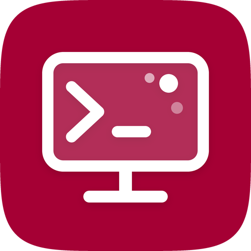

<div align="center">



<h1>Dev Manager for webOS TV</h1>

<p><strong>An iPhone companion app for LG webOS TVs in Developer Mode or with root access.</strong></p>

<p>
  <a href="https://github.com/EllipticSet/webos-dev-manager-ios/actions/workflows/build-ipa.yml"></a>
  <a href="https://github.com/EllipticSet/webos-dev-manager-ios/releases/latest"></a>
  
  <a href="LICENSE"></a>
</p>

</div>

Manage your LG TV from your iPhone over your local network: install apps from the Homebrew catalog, browse files, open a terminal, renew your Developer Mode session and read logs, all without a computer.

Inspired by [Device/DevMode Manager for webOS TV](https://github.com/webosbrew/dev-manager-desktop) by the webOS Homebrew project.

> This is an independent project, not affiliated with LG Electronics or the webOS Homebrew project.

## Features

- **Apps**: install, update and open apps, including from the [Homebrew catalog](https://repo.webosbrew.org), the non-free repository and your own repositories
- **Root settings**: turn Telnet, SSH Server, Block System Updates and Failsafe Mode on or off, and restart the TV, on TVs rooted with Homebrew Channel
- **Files**: browse, upload and download files on the TV
- **Terminal**: open an SSH terminal on your TV
- **Info**: check TV details and renew your Developer Mode session (or export a renewal script for cron)
- **Debug**: live logs, crash reports, PmLog levels and a Luna bus monitor
- **Certificates**: create SSH keys to sign in to rooted TVs without a password
- **App lock**: protect the app with Face ID or a passcode

## Requirements

| Requirement | Supported configuration |
| --- | --- |
| iPhone | iOS 26 or later |
| TV | LG webOS TV with Developer Mode enabled, or rooted (e.g. with Homebrew Channel) |
| Network | iPhone and TV on the same local network |

## Installation

There are two ways to get the app on your iPhone. Both are free and need only an Apple ID.

| | Sideload the IPA | Build with Xcode |
| --- | --- | --- |
| You need | A Mac or Windows PC and a sideloading tool | A Mac with Xcode 27 or later |
| Best for | Using the app | Changing the code |
| Updates | Download the new IPA from Releases | `git pull` and run again |

### Option 1: Sideload the IPA

Every update pushed to `main` is built automatically and published in [Releases](https://github.com/EllipticSet/webos-dev-manager-ios/releases).

1. Download **[Dev-Manager.ipa](https://github.com/EllipticSet/webos-dev-manager-ios/releases/latest/download/Dev-Manager.ipa)** from the latest release.
2. Install it with one of the tools below. The IPA is unsigned: the tool signs it with your Apple ID during installation.
3. On the iPhone, enable **Settings → Privacy & Security → Developer Mode** if asked, and restart.
4. If iOS reports an untrusted developer, open **Settings → General → VPN & Device Management**, select your Apple ID and choose **Trust**.

<details>
<summary><strong>Sideloadly</strong> (macOS and Windows, via USB)</summary>

1. Install [Sideloadly](https://sideloadly.io) and connect the iPhone with a cable.
2. Drag `Dev-Manager.ipa` onto the Sideloadly window.
3. Enter your Apple ID and select **Start**.

</details>

<details>
<summary><strong>AltStore</strong> (macOS and Windows)</summary>

1. Install AltServer on your computer and AltStore on the iPhone by following the [AltStore guide](https://faq.altstore.io).
2. Open `Dev-Manager.ipa` on the iPhone (for example from the Files app) and share it to AltStore, or select **+** in **My Apps** and choose the file.
3. Keep AltServer running on the same network so AltStore can refresh the app.

</details>

<details>
<summary><strong>SideStore</strong> (on-device, after a one-time setup)</summary>

1. Set up SideStore with the [SideStore guide](https://docs.sidestore.io).
2. In SideStore, select **+** in **My Apps** and choose `Dev-Manager.ipa`.

</details>

> [!NOTE]
> With a free Apple ID, sideloaded apps must be refreshed every 7 days and up to 3 apps can be installed at the same time. AltStore and SideStore can refresh them automatically. A paid Apple Developer account extends this to one year.

To verify a download, compare its checksum with the `Dev-Manager.ipa.sha256` file in the same release:

```bash
shasum -a 256 Dev-Manager.ipa
```

### Option 2: Build with Xcode

1. Clone the repository:

   ```bash
   git clone https://github.com/EllipticSet/webos-dev-manager-ios.git
   ```

2. Open `Dev Manager.xcodeproj` in Xcode 27 or later.
3. Select the **Dev Manager** target, open **Signing & Capabilities** and choose your own team. If the bundle identifier is already taken, change it to something unique.
4. Select your iPhone or a simulator and run the **Dev Manager** scheme.

Swift Package dependencies are resolved automatically:

- [Citadel](https://github.com/orlandos-nl/Citadel) (MIT)
- [SwiftTerm](https://github.com/migueldeicaza/SwiftTerm) (MIT)
- [Swift NIO SSH](https://github.com/apple/swift-nio-ssh) (Apache 2.0)

The project was created with Bitrig. Unit tests live in the **Dev Manager Tests** target.

## Versioning

The app version follows `MAJOR.MINOR` from the Xcode project. Each automatic build adds a build number, so releases are tagged `v<version>-build.<number>`, for example `v1.3-build.4`. The build number is also the app's `CFBundleVersion`, so a newer IPA always installs over an older one.

Changes that touch only documentation, `docs/` or `Tools/` don't produce a new build.

## Development

### Testing without a TV

`Tools/FakeTV/start.sh` starts a fake webOS TV on `127.0.0.1` (SSH on port 9922, Key Server on port 9991 with passphrase `A1B2C3`). It requires Python 3 and creates everything under `/tmp/faketv`. All keys it generates are throwaway.

The private keys in `Tests/TestKeys.swift` are test fixtures used only by the unit tests: they don't give access to any real device.

### Automatic builds

[`.github/workflows/build-ipa.yml`](.github/workflows/build-ipa.yml) builds the app on the GitHub `xcode-27` runner (the JSON project format needs Xcode 27) without code signing, packages `Payload/Dev Manager.app` into `Dev-Manager.ipa` and publishes it with its SHA-256 checksum as a new release. It can also be started manually from the **Actions** tab.

## Privacy

The app doesn't collect any data. Credentials stay in the iPhone's keychain and are used only to connect to your TVs. The only external services contacted are `repo.webosbrew.org` (Homebrew catalog) and `developer.lge.com` (Developer Mode status and renewal).

## Support

Report problems or suggest changes in [Issues](https://github.com/EllipticSet/webos-dev-manager-ios/issues). Include the app version (shown in **About**), your iOS version and your TV model and webOS version. Remove private information, such as IP addresses or passphrases, before posting.

## Acknowledgements

This app is based on the ideas and workflows of [webosbrew/dev-manager-desktop](https://github.com/webosbrew/dev-manager-desktop), released under the Apache License 2.0. Many thanks to the webOS Homebrew community.

<details>
<summary>Disclaimer</summary>

Dev Manager is an independent developer tool. It isn't affiliated with, sponsored by, or approved by LG Electronics or the webOS Homebrew project. webOS is a trademark of its respective owners. Use at your own risk.

</details>

## License

Released under the [Apache License 2.0](LICENSE).
